# October 12: Designed the PCB layout, and also put into place most of the things

I spend some hours designing the layout. I also finished the schematics, and the I put everyting into place. 

here are some photos: 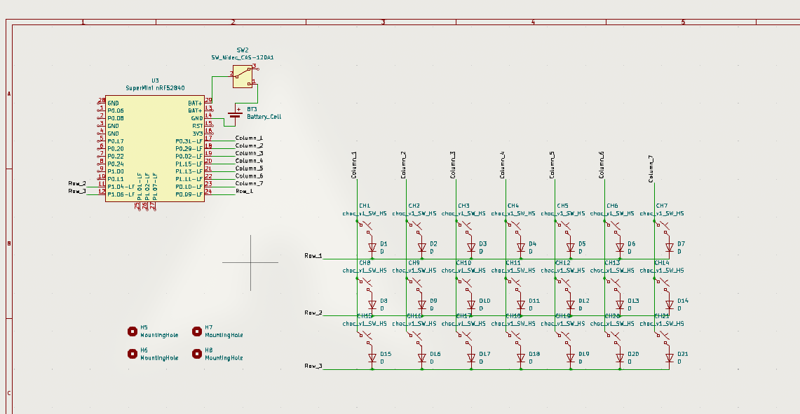 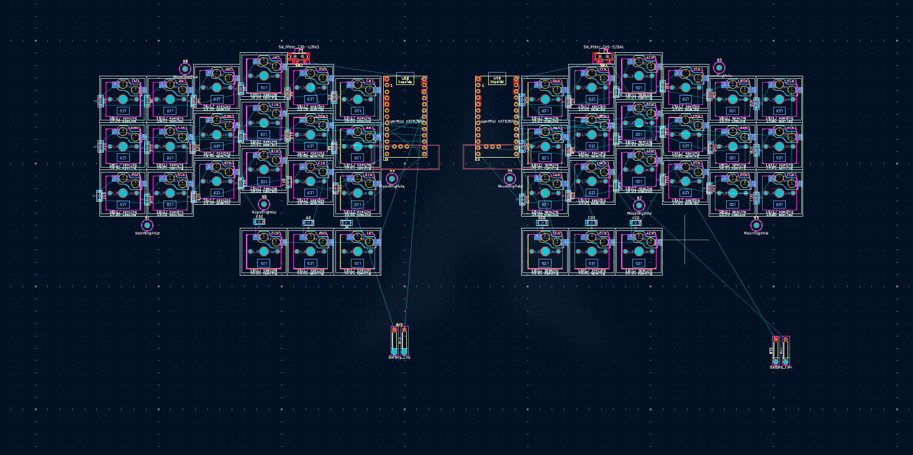

I tracked everything with lapse, it was my first time using lapse, and it is nice to see eveything you did.
I also had some problem with kicad. I use kicad before but I recently swtiched to ARCH, and had some problem, but I ended up fixing it with the help of claude code. And then I imported the config from my old system.
**Total time spent: Almost 3,5 hours**

# October 25: I Finished wiring everything and also made the PCB outline

I have spent around 3 hours wiring everything. I also changed the battery footprint for a battery connector since I thought that a conector would be much better than soldering the battery cell to the PCB directly. 
Here are some photos of the process: 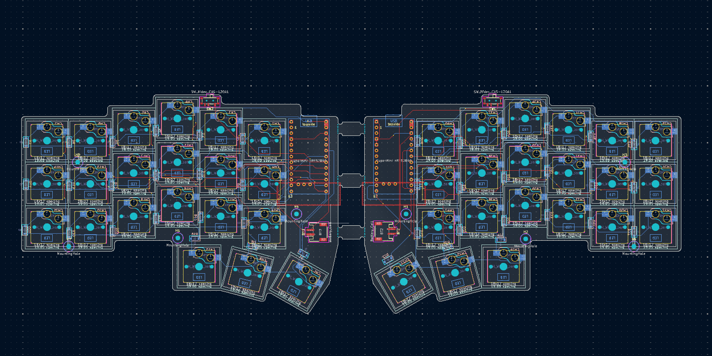 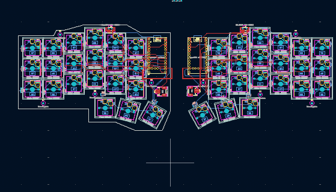
**Total time spent: 3 hours**

# October 30: I made some general progress. 

I changed some thing in the PCB, added a receiver for the wireless connection. And I started the case design in freecad. But I have never used freecad before, and it was really had for me to get used to it. I have spent around 2 hours trying to figure out how to use freecad, and I still couldnt. I thought about switching to fusion but I ended up continuing with freecad. Since I wanted to end up learning it since there is no fusion in linux. 
Here are some photos of the process: 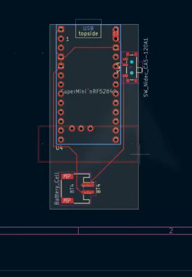 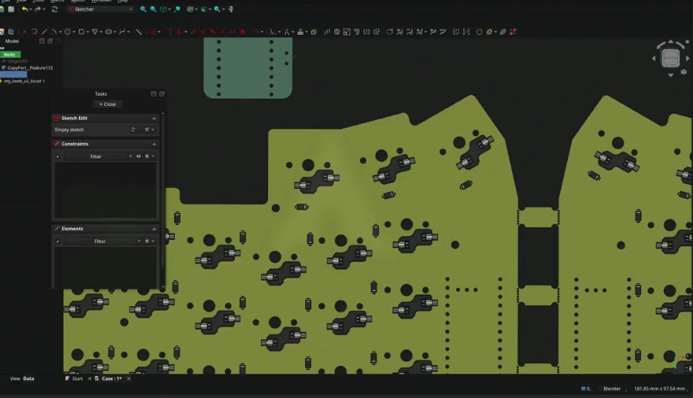 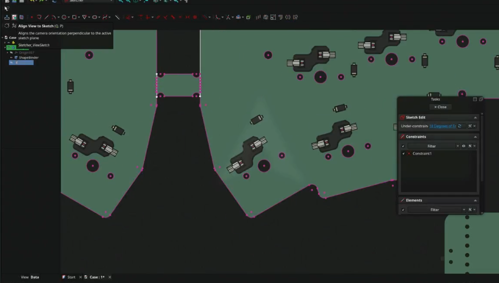
**Total time spent: 1 hour and 45 minutes**

# November 1: I starting getting used to freecad.

I have made some progress. But more importantly I got used to freecad what made me be much faster in the following sessions.
Here are some photos of the process: 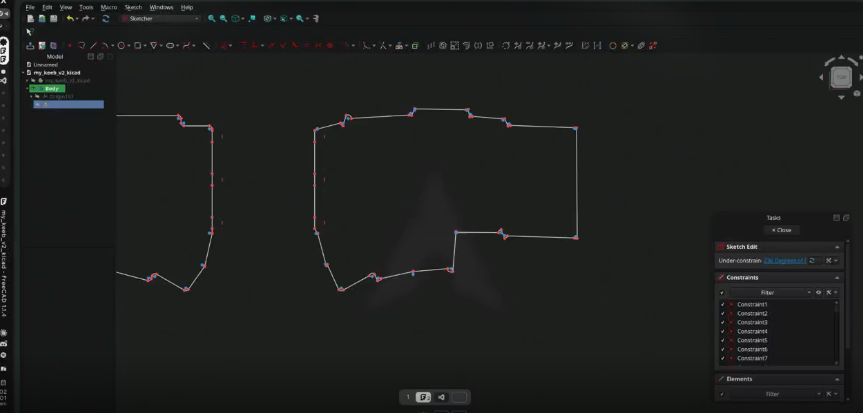 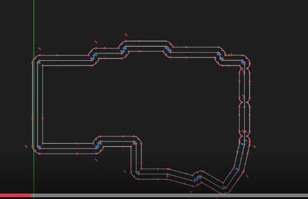 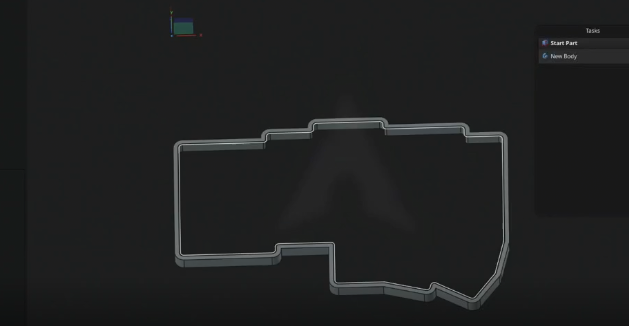 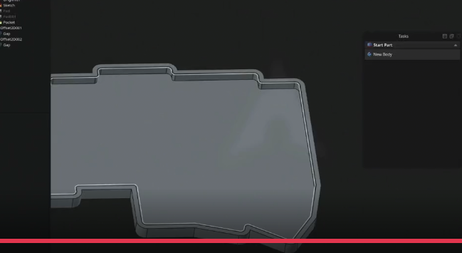
**Total time spent: 1 hour and 30 minutes**

# November 2: I have made major progress in the case design. 

It is near begin complete. But there where some important design changes. I made the keyboard compatible with both V1 and V2 choc switches using a custom footprint. I had to reroute some wires in the pcb to make it compatible with both switches. I also decided to add a nice!view screen. I have investigated a bit and they fit really well what I need. They are fast and they dont are similar to e-ink displays. I have added the display to the schematics and the PCB. The PCB is fully routed, I added some more mountholes for having something to cover the screen and microcontroller.
Here are some photos of the process: 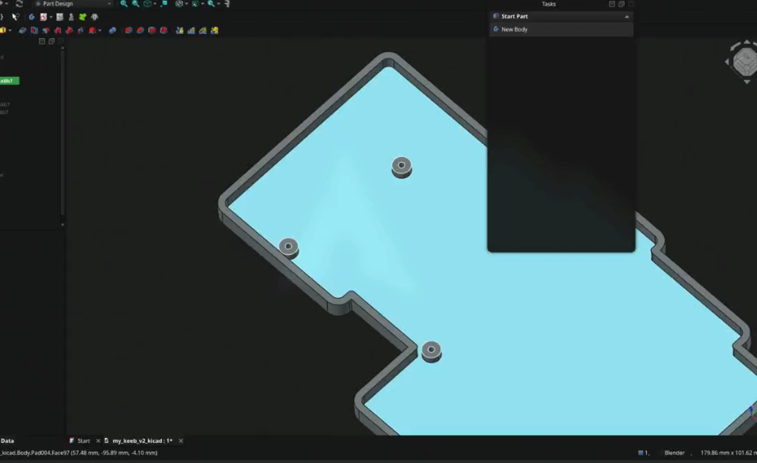 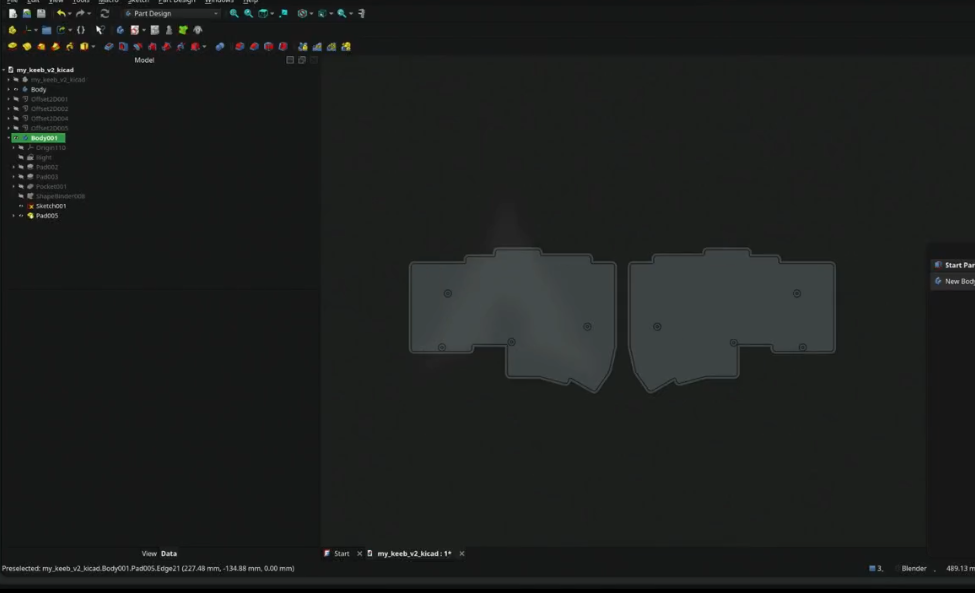 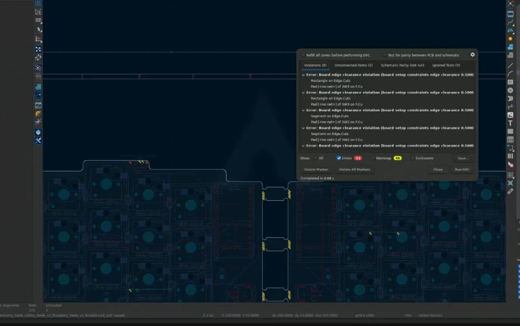 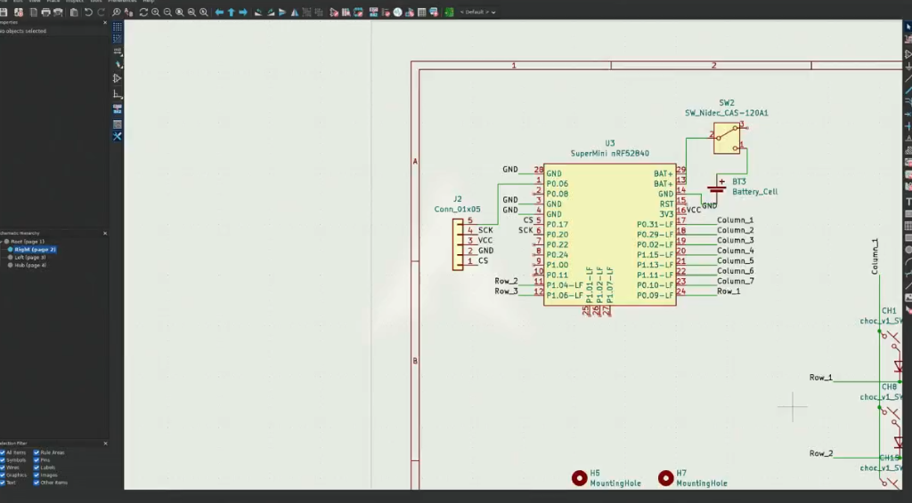
** Almost 4 hours**